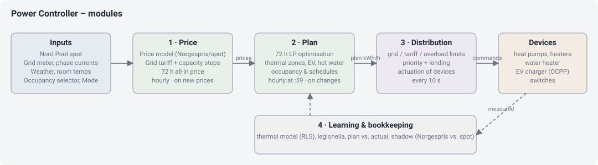
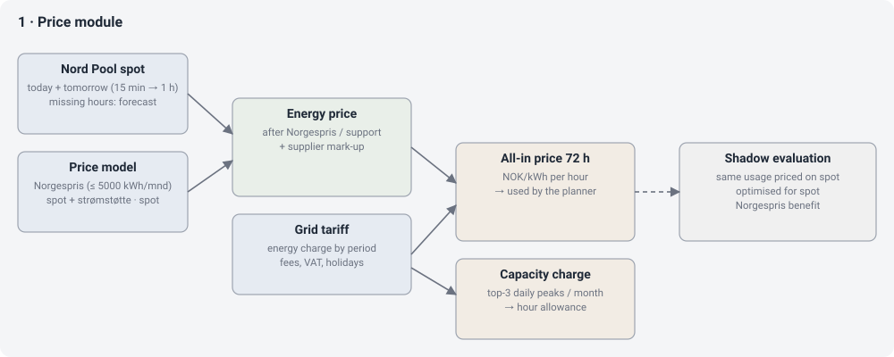
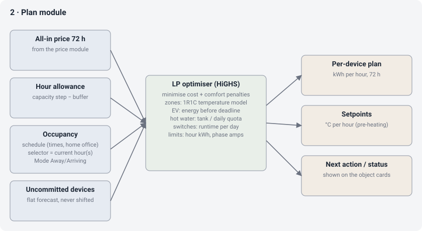
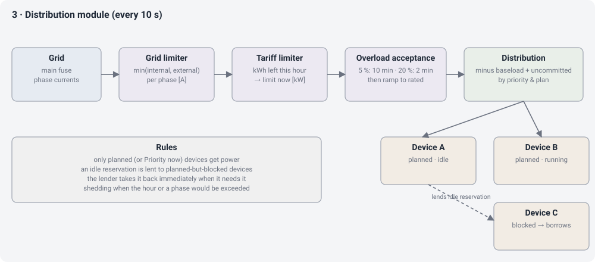

<p align="center"></p>

# Power Controller (Home Assistant)

> ⚠️ **Work in progress.** The calculation and planning engines are covered by unit tests. The
> Home Assistant layer and the frontend have been checked with stubs/mocks; verify in your own
> installation before you let it control many devices.

Power Controller is a home energy management system (HEMS) for a Norwegian household on a
230 V IT grid. It decides **when** controllable loads (heat pumps, panel heaters, floor heating,
water heater, EV charger, switches) should use power, and **how much** they may use right now,
so that the total cost of **electricity + grid tariff** is as low as possible while keeping
comfort and staying within the capacity step and the main fuse / phase currents.

## How it works – three modules



| Module | Runs | Question it answers | Main output |
|---|---|---|---|
| **1 · Price** | hourly and when new prices arrive | What does one kWh cost in each of the next 72 hours? | all-in price per hour, hour allowance (capacity step) |
| **2 · Plan** | hourly at :59 and on every change | When should each device use energy, given prices, comfort and limits? | power and setpoint per device in 15-minute slots for 72 h |
| **3 · Distribution** | every 10 seconds | How much may each device use *right now* without exceeding the hour or a phase? | power per device, actuation of the devices |

Energy this hour is integrated from the grid power (or your own hourly utility meter); the month
(energy, cost, top-3, Norgespris) is rebuilt from the meter's recorder statistics after every
restart and every hour. Optional **notifications** (one `notify.*` service) report errors and early
warnings with action buttons.

**Household appliances** (dishwasher, oven, washer) are read only: a delayed start or a running
program is added to the plan as a fixed load, using an energy register learned per program.

A fourth background part learns the thermal behaviour of each room, tracks the legionella cycle,
records **plan vs. actual** and runs the **Norgespris vs. spot** shadow evaluation.

### 1 · Price


- **Price model:** Norgespris (fixed price up to the monthly volume, spot above it), spot with
  electricity support (strømstøtte) or plain spot. Missing spot hours are forecast from the same
  weekday last week, scaled to today's level.
- **Grid tariff:** fully editable in the UI – price-list versions with a valid-from date,
  time-of-use periods (weekdays, hours, months), fees, VAT and capacity steps.
- **Capacity charge:** the average of the three highest hourly peaks on three different days.
  The hour allowance uses peaks that are already "paid for" this month.
- **Norgespris remaining:** used/remaining volume this month and the projected date it runs out.
- **Shadow evaluation:** prices the same consumption on spot, and what an optimiser planning for
  spot would have paid – so you can see whether Norgespris is actually cheaper for you.

### 2 · Plan


- A linear optimisation (HiGHS) over 72 hours in **15-minute slots** (Nord Pool quarter prices) with
  a self-learning temperature model per room, pre-heating, EV deadlines, hot-water tank/quota,
  legionella and switch runtimes. The capacity charge is enforced per clock hour.
- **EV:** charge to the target by a deadline, or with *no deadline* (cheapest within 72 h with a
  small cost per hour of delay). Optional **minimum state of charge** (default 30 %) within 24 h of
  plugging in – fixed per session.
- **Heater type:** stepless (modulating, e.g. heat pump) or on/off (panel heater, cable).
- **All controllable devices are included.** Devices that are *not committed* (not controlled) are
  added as a flat, never-shifted forecast so the plan and limits reflect the real consumption:
  heating holds its own setpoint, hot water/switches use their daily amount spread over the day,
  and an EV only counts when it is connected **and** actually charging.
- **When are we home?** The times on the Power Controller device (wake, leave, return, bedtime)
  build the schedule. A device can optionally use its own *schedule* helper instead.
- **Mode** (Home / Away / Arriving) is the long-term picture: Away uses out-of-town temperatures,
  Arriving pre-heats to the arrival time.
- **Occupancy** (select) is the situation *now*: Home and awake, Sleeping, Away (work),
  Home office. Set it yourself or from your own automation. It decides the current hour(s);
  the schedule decides the later hours. Rules:
  - while the selector says *Home and awake*, rooms that need comfort are never lowered, even if
    the schedule says bedtime;
  - *Away (work)* after the scheduled return keeps the house warm (you may arrive any minute);
  - Mode *Away* ignores the selector.

### 3 · Distribution


**Command patience:** new setpoints/currents are only sent when the change is meaningful
(EV ≥ 2 A, setpoint ≥ 0.5 °C) and at most every 5 minutes – every 30 minutes for heaters regulated by
an external room sensor (heat pumps), whose regulator also has hysteresis. Reductions go out at once only when the
hour allowance or a phase is at risk. All three values are adjustable.

Every 10 seconds: **grid limiter** (main fuse, internal/external per phase) → **tariff limiter**
(kWh left this hour) → **overload acceptance** (5 % for 10 min, 20 % for 2 min, ≥ 50 % at once,
then ramp to rated) → **distribution**. Baseload and devices that are not committed are subtracted
first. Only planned devices (or *Priority now*) get power; a reservation that is idle (thermostat
satisfied) is lent to planned-but-blocked devices and taken back immediately when needed. A stepless
heater (heat pump) lends the unused part of its reservation (grant − live − margin).

## Dashboards

### Super-user panel (sidebar, admins)
One page per module so it is clear what each part does:

| Page | Content |
|---|---|
| **Overview** | *Now & history*: KPIs, power per device last hour, phase currents/voltages last 24 h, consumption 3 days back / 3 days ahead · *Plan*: next 24 h and the device list |
| **Price** | price split (energy/grid), 72 h price, Norgespris volume and projection, grid tariff, Norgespris vs. spot |
| **Plan** | 72 h plan (incl. forecast for uncommitted devices), occupancy selector and 7-day schedule, plan vs. actual |
| **Distribution** | live flow grid → limiters → distribution → devices, incl. lending arrows, phases and the decision per device |
| **Devices / Priorities** | object cards and drag-and-drop priority order |
| **Settings** | the values you change often, each with a "?" explanation; **thermal models** per zone (what has been learned, manual adjustment, reset) |

History comes from the Home Assistant recorder (no extra storage). Plan vs. actual keeps 7 days.
Every chart has a full-screen button.

### Object card (everyday dashboards)
Loaded automatically – add **Power Controller object** in the dashboard editor or:

```yaml
type: custom:power-controller-object-card
entity: sensor.pc_heat_pump_plan      # the device's plan sensor
show_plan: true                       # 24 h strip: kWh per hour (bars) + setpoint °C (line), tap for values
show_distribution: true               # live status from the distribution module
show_targets: true                    # comfort/eco, nominal temp, runtime, EV target
```

- **Committed:** distribution status, 24 h plan with axis and units, next action, targets,
  *Priority now*, and – when an external room sensor regulates the device – an expandable
  **Regulator** section (room temp, target, error, P and I terms, offset, setpoint sent).
- **Uncommitted:** normal controls for the entity and the *forecast* the plan uses for it.

## Installation
1. HACS → add this repository (category *Integration*) → install, restart Home Assistant.
2. *Settings → Devices & services → Add integration → Power Controller.* The first entry is the
   hub (grid meter, phase currents, Nord Pool, outdoor temperature; optional: weather, external
   limiter, phase voltages). Then add thermal zones (window sensor optional) and one entry per load.
3. *Configure → Grid tariff:* check prices and capacity steps against your grid operator.
4. Set the times on the Power Controller device and connect your own presence/sleep logic to the
   **Occupancy** select.

Requires `numpy` and `scipy` (installed automatically).

## Development
See [`docs/PROJECT_HANDOVER.md`](docs/PROJECT_HANDOVER.md) for architecture, design decisions,
known gaps and how to continue development.

```bash
pip install pytest numpy scipy
pytest -q
```
GitHub Actions runs the tests, hassfest and HACS validation on every push.
